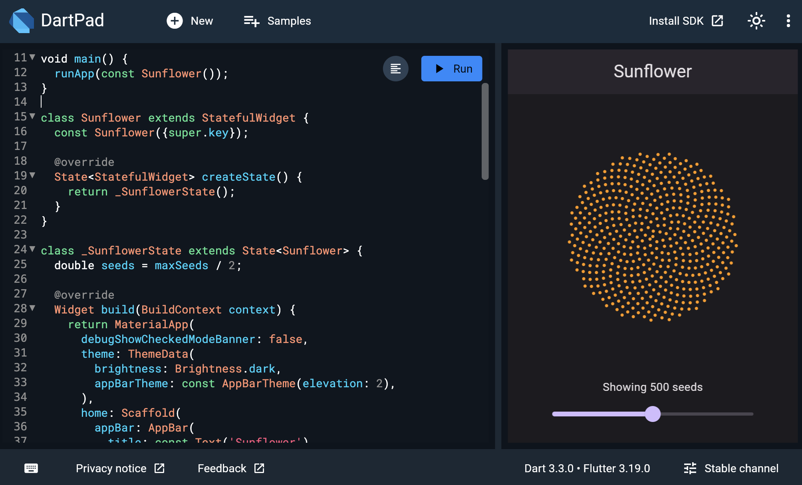

# DartPad

DartPad is a free, open-source online editor to help developers learn about Dart
and Flutter. You can access it at [dartpad.dev](https://dartpad.dev).

DartPad edits and runs Dart and Flutter code in the browser, with analysis and
compilation running locally in a WebWorker.

## What's here?

[](https://github.com/dart-lang/dart-pad/actions/workflows/dartpad.yml)

The repository root is a Dart workspace with these packages:

| Package                                               | Description                                                     |
| ----------------------------------------------------- | --------------------------------------------------------------- |
| [dartpad_frontend](pkgs/dartpad_frontend/)            | The Jaspr web app served at dartpad.dev                         |
| [dartpad_editor](pkgs/dartpad_editor/)                | Editor, language-server, and workspace building blocks          |
| [codemirror-dart](pkgs/codemirror-dart/)              | Dart wrapper around the CodeMirror 6 editor                     |
| [codemirror-lang-dart](pkgs/codemirror-lang-dart/)    | Dart language support for CodeMirror 6                          |
| [examples](pkgs/examples/)                            | Bundled examples, loaded with the `sample=` query parameter     |

## Link or embed

### Project source

Choose one source per URL.

| Query                              | Source                                                                                  |
| ---------------------------------- | --------------------------------------------------------------------------------------- |
| `sample=<id>`                      | Bundled sample: `counter`, `sunflower`, `fibonacci`, `flame-game`, `dart`, or `flutter` |
| `gist=<id>`                        | GitHub Gist                                                                             |
| `package=<name>`                   | Latest version of a pub.dev package                                                     |
| `package=<name>&version=<version>` | Exact pub.dev package version; `version` requires `package`                             |
| `url=<url>`                        | Tar archive, optionally gzip compressed;                                                |

### Project configuration

| Query                            | Effect                                                                                            | Default                                                                                               |
| -------------------------------- | ------------------------------------------------------------------------------------------------- | ----------------------------------------------------------------------------------------------------- |
| `file=<path>`                    | Initial editor tab; repeat for multiple tabs in order, with the first active                      | The root README or resolved entrypoint                                                                |
| `root=<path>`                    | Directory for the file tree, analysis, and dependency resolution; `root=` selects the source root | Common package root of explicit files and entrypoint, otherwise source root                           |
| `entrypoint=<path>`              | File executed by Run, independent of the active tab                                               | First initial Dart file with a top-level `main`, then `<root>/lib/main.dart`, then `<root>/main.dart` |
| `sdk=dart` or `sdk=flutter`      | SDK kind; append `:<version>` to select an exact bundled version                                  | Inferred from the root pubspec or Gist imports; first available bundle of that kind                   |
| `mode=console` or `mode=flutter` | Execution mode; Flutter mode requires a Flutter SDK                                               | Flutter with a Flutter SDK, except entrypoints under `bin/`, `test/`, or `tool/`; otherwise console   |

- All paths are source-relative, including when `root` is set. For example,
  `root=example&file=example/lib/main.dart`.
- Gists move root-level Dart files into `lib/`; original paths such as
  `file=main.dart&entrypoint=main.dart` still work.
- SDK versions must be available in the [bundled SDK list](pkgs/dartpad_frontend/lib/sdks.g.dart).

### Appearance and execution

| Query                         | Effect                                                                                        | Default                                          |
| ----------------------------- | --------------------------------------------------------------------------------------------- | ------------------------------------------------ |
| `embed=true`                  | Hide the app bar, footer, and file navigation; wait for Run before runtime startup            | Standalone layout; Run the preview automatically |
| `panels=<panel-list>`         | Initial panel configuration; `+` expands, `-` collapses in standalone mode or hides in embeds | Inferred from context; see below                 |
| `theme=dark` or `theme=light` | Initial theme                                                                                 | Saved preference, otherwise system theme         |

### Panel configuration

The URL sets each panel's initial state, but these are interpreted as hints.
Existing panel controls can change the layout afterwards. The app bar and status bar
do not have their own reopening controls.

Use comma-separated panel names, each prefixed with `+` or `-`.
`+` expands a panel. `-` collapses it in standalone mode and hides it in embeds.
The exception is `-tabs`, which hides tabs and breadcrumbs in both modes.

```text
?embed=true&panels=+tabs,-filetree,-preview
```

| Panel       | Standalone default | Embed default                                               |
| ----------- | ------------------ | ----------------------------------------------------------- |
| `console`   | Expanded           | Collapsed                                                   |
| `problems`  | Expanded (active)  | Collapsed (active)                                          |
| `preview`   | Expanded           | Expanded                                                    |
| `tabs`      | Expanded           | Hidden, unless multiple distinct `file` values are supplied |
| `filetree`  | Expanded           | Hidden                                                      |
| `statusbar` | Expanded           | Hidden                                                      |
| `appbar`    | Expanded           | Hidden                                                      |

Tabs and breadcrumbs are shown together whenever multiple files are open, even
with `-tabs`, so users can switch between files. When only one file remains open,
they return to the configured visibility.

#### Bottom panel behavior

`console` and `problems` share the bottom area:

- The bottom area expands if either resolved tab is expanded, otherwise collapses if either is collapsed, otherwise hides. In embeds, hiding requires `-console,-problems`.
- The last positive hint (`+console` or `+problems`) selects that tab. Without a positive hint, the more visible tab is selected (for example, `-console` in standalone selects Problems).
- In standalone mode, a single negative hint (`-console` or `-problems`) keeps the area expanded and selects the other tab; both must be `-` to collapse the area.

### Examples

```html
<iframe
  src="https://dartpad.dev/?sample=counter&amp;embed=true&amp;theme=light"
  title="Flutter counter example"
  width="100%"
  height="600"
  style="border: 0"
></iframe>
```

## Develop locally

Requirements:

- Dart 3.12 or later.
- Jaspr CLI (installed by `dart pub get`, invoked via `dart run`).
- Chrome for tests.

From the repository root:

```bash
dart pub get
cd pkgs/dartpad_frontend
dart run tool/setup_sdk_assets.dart
cd ../examples
dart run build_examples.dart
cd ../dartpad_frontend
dart run jaspr_cli:jaspr serve -v
```

- Open <http://localhost:8080/>.
- SDK assets and example archives only need regenerating when missing or changed.
- See [Development details](pkgs/dartpad_frontend/doc/development.md) for asset updates and CodeMirror builds.

Frontend checks and builds, from `pkgs/dartpad_frontend`:

| Task             | Command                                                         |
| ---------------- | --------------------------------------------------------------- |
| Check formatting | `dart format --output=none --set-exit-if-changed lib test tool` |
| Analyze          | `dart analyze --fatal-infos`                                    |
| Test in Chrome   | `dart test`                                                     |
| Build            | `dart run jaspr_cli:jaspr build`                                |

## Further reading

| Document                                                                  | Audience                                                       |
| ------------------------------------------------------------------------- | -------------------------------------------------------------- |
| Document                                                                  | Audience                                                       |
| [Development details](pkgs/dartpad_frontend/doc/development.md)           | Contributors updating generated assets                         |
| [Startup design](pkgs/dartpad_frontend/doc/startup-design.md)             | Contributors working on project loading and execution          |
| [Frontend UI](pkgs/dartpad_frontend/README.md)                            | Contributors working on the Jaspr UI                           |
| [Editor package](pkgs/dartpad_editor/README.md)                           | Contributors working on editor and language-server integration |
| [Examples](pkgs/examples/README.md)                                       | Contributors adding bundled samples                            |
| [Sharing Guide](https://github.com/dart-lang/dart-pad/wiki/Sharing-Guide) | Users sharing DartPad links                                    |

## Background

DartPad began as an online playground for the Dart language built by the Dart
tools team in 2015. It compiles, analyzes, and displays the results of its
users' Dart code, and can be embedded in other websites as an iframe.

In Dec 2019, we launched a new version of DartPad (dartpad.dev) with a fresh new
look-and-feel and support for the popular Flutter UI toolkit. To learn more
about the new DartPad, please check this [blog
post](https://medium.com/dartlang/a-brand-new-dartpad-dev-with-flutter-support-16fe6027784).
Interested in embedding DartPad in your websites? Check out this [embedding
guide](https://github.com/dart-lang/dart-pad/wiki/Embedding-Guide).



## Issues and bugs

Please file reports on the [GitHub Issue
Tracker](https://github.com/dart-lang/dart-pad/issues).

## License and Contributing

Contributions welcome! Please read this short
[guide](https://github.com/dart-lang/dart-pad/blob/main/CONTRIBUTING.md)
first. You can view our license
[here](https://github.com/dart-lang/dart-pad/blob/main/LICENSE).
